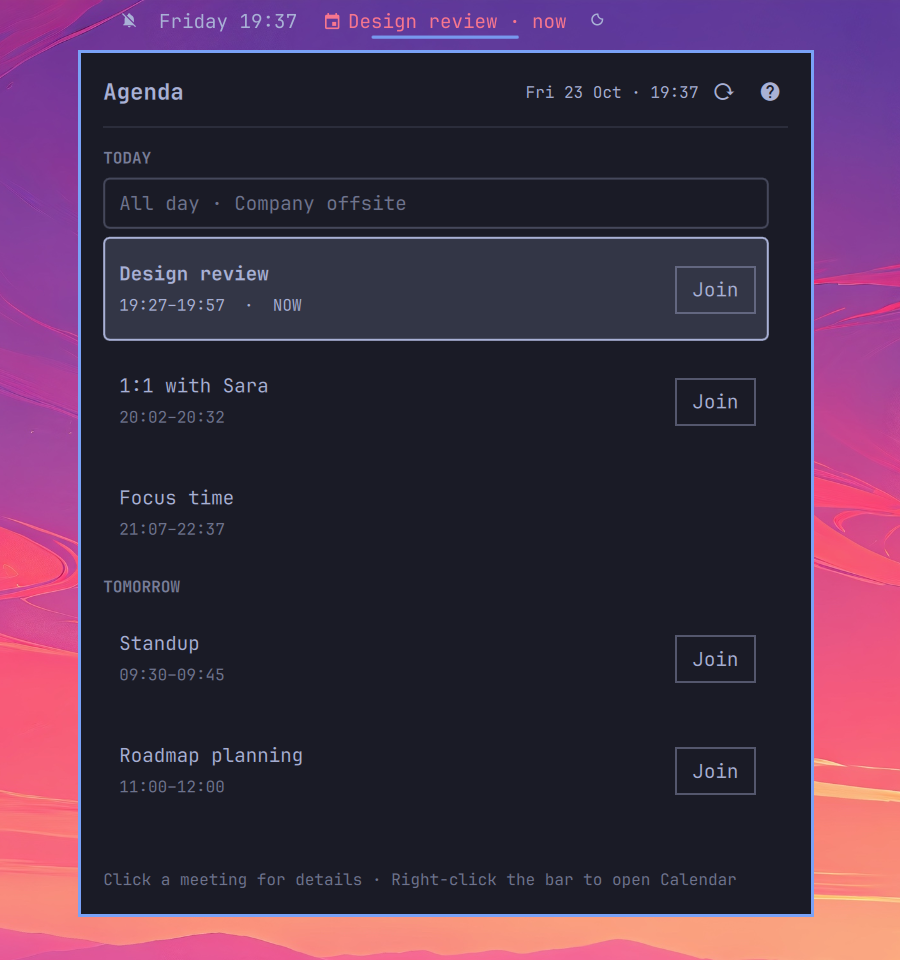
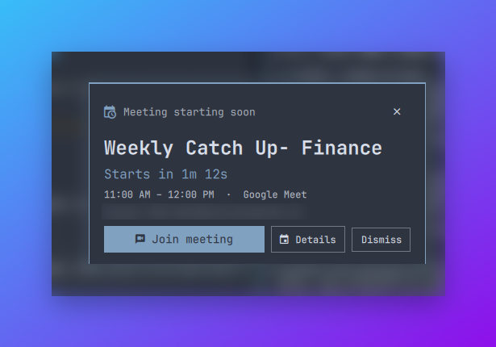
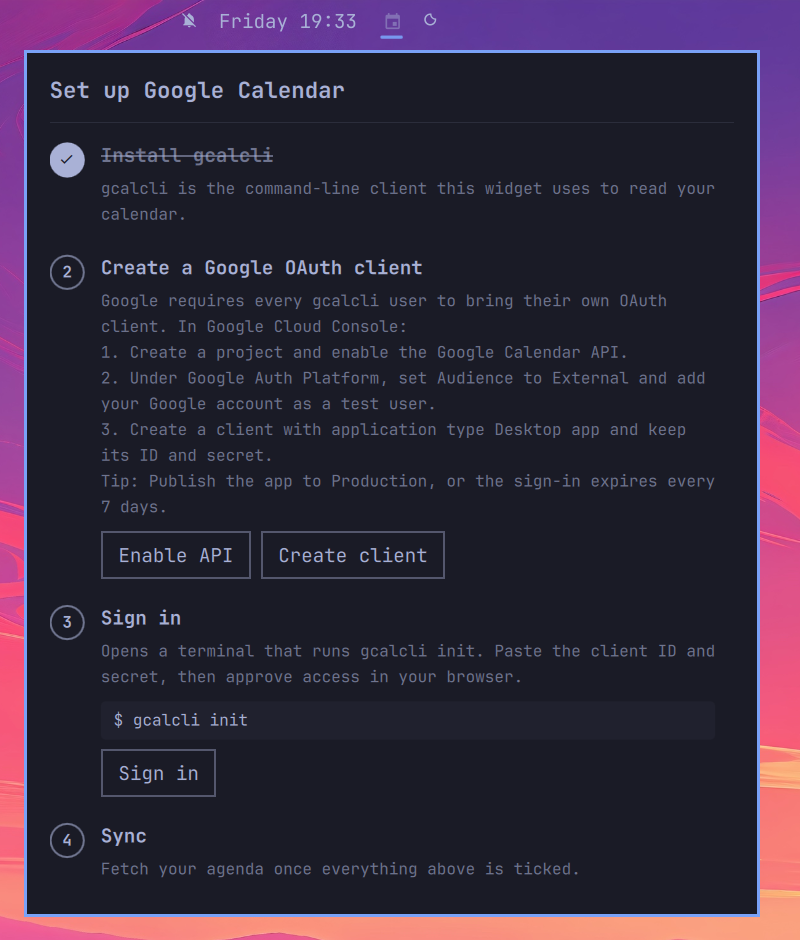

<h1 align="center">Google Calendar for Omarchy</h1>

<p align="center">
  Your next meeting in the Omarchy bar, an agenda popup with one-click Google Meet links, and a reminder before every meeting. Setup is guided from inside the popup.
</p>

<p align="center">
  
</p>

## What it does

- **Bar widget**: the next event within 12 hours with a countdown, such as `󰃭 Standup in 12m`. It highlights in the last five minutes and shows `now` once a meeting has started.
- **Agenda popup**: today and the next few days, grouped by day, with the current and next meeting highlighted and a **Join** button on every event with a video link. Arrow keys move through the list and Enter opens the details.
- **Meeting reminder**: a full-screen card with a live countdown, **Join meeting**, **Details** and **Dismiss**, shown a couple of minutes before each meeting. You can switch it to a desktop notification.
- **Setup guide**: a checklist in the popup that walks you through Google Calendar setup and ticks each step off as it detects it.
- **Theme-aware**: colors and fonts come from the active Omarchy theme.

| Mouse | Action |
|---|---|
| Left-click | Open or close the agenda |
| Middle-click | Sync now |
| Right-click | Open Google Calendar |

<p align="center">
  
</p>

## Requirements

- Omarchy with the Quickshell-based shell (Omarchy Quattro)
- `python3` (standard library only)
- [gcalcli](https://github.com/insanum/gcalcli) 4.5 or newer, installed in step 1 below
- A Google account and your own Google Cloud OAuth client (free), created in step 2 below

## Install

```bash
omarchy plugin add https://github.com/hussainanjar/omarchy-gcal.git --enable
```

The widget appears in the center section. Move it with `omarchy bar move io.github.hussainanjar.gcal --section right`.

## Set up Google Calendar

The widget reads your calendar through [gcalcli](https://github.com/insanum/gcalcli). Google requires every gcalcli user to create their own OAuth client, so setup takes about five minutes the first time. **Click the widget**: until setup is done, the popup shows this checklist with buttons for each step.

<p align="center">
  
</p>

### 1. Install gcalcli

```bash
omarchy pkg aur add gcalcli
```

`pipx install gcalcli` works too. If gcalcli is not on your `PATH`, set **Path to gcalcli** in the widget settings.

### 2. Create a Google OAuth client

In the [Google Cloud Console](https://console.cloud.google.com/):

1. Create a project (any name), then open **APIs & Services → Library**, search for **Google Calendar API** and click **Enable**. [Direct link](https://console.cloud.google.com/apis/library/calendar-json.googleapis.com).
2. Open **Google Auth Platform**. On **Branding**, set an app name and your email. On **Audience**, choose **External** and add your Google account under **Test users**.
3. On **Clients**, click **Create client**, choose application type **Desktop app**, and note the **Client ID** and **Client secret**. [Direct link](https://console.cloud.google.com/auth/clients/create).

> [!TIP]
> While the app is in **Testing**, Google expires the sign-in after 7 days. On the **Audience** page, click **Publish app** to move it to Production. A personal app that only you use does not need Google's verification; you only click past an "unverified app" warning once when signing in.

> [!NOTE]
> Using a Google Workspace (work) account? Your admin may need to allow third-party apps, or you can create the project inside your organization and pick **Internal** as the audience. Internal apps do not expire.

### 3. Sign in

Click **Sign in** in the popup, or run the guided setup in a terminal:

```bash
~/.config/omarchy/plugins/io.github.hussainanjar.gcal/bin/gcal-agenda setup
```

It runs `gcalcli init`. Paste the client ID and secret, approve access in the browser, and the token is saved to `~/.local/share/gcalcli/oauth`.

### 4. Sync

Setup syncs once when it finishes. After that the widget syncs on its own, every 5 minutes by default. Middle-click the bar or press **Sync now** to sync immediately.

## Settings

Change these in Omarchy's bar widget settings, or inline on the widget entry in `~/.config/omarchy/shell.json`:

| Setting | Default | |
|---|---|---|
| `daysAhead` | `2` | Days of agenda to show |
| `refreshMinutes` | `5` | Minutes between syncs |
| `reminderMinutes` | `2` | Minutes before a meeting to remind; `0` turns reminders off |
| `reminderStyle` | `Popup` | `Popup` for the full-screen card, `Notification` for a desktop notification |
| `calendars` | empty | Comma-separated calendar names to include; empty includes every calendar |
| `gcalcliPath` | empty | Path to gcalcli when it is not on `PATH` |

```json
{ "id": "io.github.hussainanjar.gcal", "reminderMinutes": 5, "calendars": "Work, Family" }
```

## Troubleshooting

| Symptom | Fix |
|---|---|
| The bar icon is dimmed and the popup shows the setup guide | gcalcli is missing or not signed in. Follow the unticked steps. |
| "Google sign-in expired, sign in again" | The OAuth app is still in Testing (7-day tokens). Publish it to Production, then sign in again. |
| `Error 403: access_denied` in the browser | Your account is not in the **Test users** list of the OAuth app. |
| Events from a calendar are missing | Check the `calendars` setting. Names must match `gcalcli list` exactly. |
| Anything else | Run `bin/gcal-agenda fetch` from the plugin folder and read the error. The cache lives at `~/.cache/omarchy-gcal/agenda.json`. |

Shell IPC, handy for keybindings and scripts:

```bash
omarchy-shell io.github.hussainanjar.gcal toggle          # agenda popup
omarchy-shell io.github.hussainanjar.gcal.setup open      # setup guide
omarchy-shell io.github.hussainanjar.gcal.meeting preview # reminder card for the next meeting
```

## Remove

```bash
omarchy plugin remove io.github.hussainanjar.gcal
rm -rf ~/.cache/omarchy-gcal
```

The plugin never writes outside `~/.cache/omarchy-gcal`. Your Google sign-in belongs to gcalcli; to remove it too, delete `~/.local/share/gcalcli/oauth`, revoke access at [Google Account permissions](https://myaccount.google.com/permissions), and uninstall gcalcli if nothing else uses it (`omarchy pkg drop gcalcli`).

## How it works

`bin/gcal-agenda` (Python 3, standard library only) calls `gcalcli agenda --tsv` and writes `~/.cache/omarchy-gcal/agenda.json`. Every 30 seconds the widget runs `gcal-agenda tick`, which re-syncs once the cache is older than `refreshMinutes` and returns the meetings that need a reminder. A file lock means that with a bar on every monitor, the calendar is still fetched once and each reminder appears once. Your Google token never leaves gcalcli's own storage.

## License

MIT
